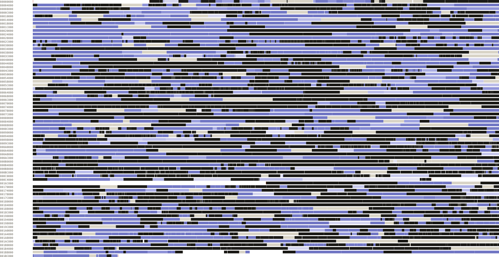

# Turok: Rage Wars decompilation

A matching decompilation of *Turok: Rage Wars* for the Nintendo 64.

> **This repository contains no game content.** You must supply a legally acquired cartridge dump. Builds are verified against its SHA256.

## Progress

<!-- progress -->
<pre><code>all      [███████████▒▒▒▒▒▒░░░]  56.23% (~86.58%)  3,856,240 of 6,857,872 bytes</code> <code>de       [███████████▒▒▒▒▒▒░░░]  57.28% (~87.31%)  791,976 of 1,382,608 bytes</code> <code>eu       [██████████▒▒▒▒▒▒░░░░]  53.02% (~82.94%)  735,736 of 1,387,504 bytes</code> <code>eu-x     [██████████▒▒▒▒▒▒░░░░]  52.01% (~83.48%)  685,664 of 1,318,176 bytes</code> <code>us       [███████████▒▒▒▒▒▒░░░]  58.86% (~88.54%)  814,047 of 1,382,992 bytes</code> <code>us-rev1  [███████████▒▒▒▒▒▒▒░░]  59.77% (~90.46%)  828,817 of 1,386,592 bytes</code></pre>

| de (NUS-NRWD-0, Germany). Censored German release. SHA256 `9dc401252bacb2ad7412ef003f97f28cb225d76b3cc76f430fbc27fa05067ca8` |
|---|
| <pre><code>code      [█████████▒▒▒▒▒▒▒▒░░░]  47.94% (~85.51%)  529,916 of 1,105,260</code> <code>data      [██████████████████░░]  94.48%  262,060 of 277,348</code> <code>functions [████████████▒▒▒▒▒▒░░]  60.08% (~94.20%)  2,074 of 3,452</code></pre> |

| eu (NUS-NRWP-0, Europe). PAL release. SHA256 `d763cbbe485a5f9e1b7be97d5ac16735087e23d0bb62c05dc844e01b7e1156d1` |
|---|
| <pre><code>code      [█████████▒▒▒▒▒▒▒░░░░]  47.65% (~84.99%)  529,908 of 1,111,912</code> <code>data      [██████████████░░░░░░]  74.68%  205,828 of 275,592</code> <code>functions [███████████▒▒▒▒▒▒▒░░]  59.61% (~93.69%)  2,062 of 3,459</code></pre> |

| eu-x (NUS-NRWX-0, Europe). PAL multi-language release. SHA256 `511f6c876586bf401faf01a270c67f26fcb7db55ed3f35759c71ab15a29de750` |
|---|
| <pre><code>code      [█████████▒▒▒▒▒▒▒░░░░]  47.63% (~84.93%)  529,824 of 1,112,232</code> <code>data      [███████████████░░░░░]  75.67%  155,840 of 205,944</code> <code>functions [███████████▒▒▒▒▒▒▒░░]  59.79% (~93.98%)  2,067 of 3,457</code></pre> |

| us (NUS-NRWE-0, North America). First NTSC release (black cartridge). SHA256 `0433043aaba2649bdd1fe717c4020550ac663c0362527aa082490f5977a3e46b` |
|---|
| <pre><code>code      [█████████▒▒▒▒▒▒▒▒░░░]  49.27% (~87.85%)  524,356 of 1,064,056</code> <code>data      [██████████████████░░]  90.83%  289,691 of 318,936</code> <code>functions [████████████▒▒▒▒▒▒▒░]  60.89% (~95.24%)  2,048 of 3,363</code></pre> |

| us-rev1 (NUS-NRWE-1, North America). Revised NTSC release (grey cartridge). SHA256 `5dfbae59e4a3860b740ccbb28f33aad624315e30bfca6d60abd62d12a89e0089` |
|---|
| <pre><code>code      [██████████▒▒▒▒▒▒▒░░░]  50.76% (~88.41%)  573,712 of 1,130,188</code> <code>data      [███████████████████░]  99.49%  255,105 of 256,404</code> <code>functions [████████████▒▒▒▒▒▒▒░]  61.98% (~96.53%)  2,162 of 3,488</code></pre> |
<!-- /progress -->

## Development & Contributions

Contributions and corrections are welcome. Run `make check` before opening a pull request.

For detailed instructions please see [CONTRIBUTING.md](CONTRIBUTING.md).

## License

[CC0 1.0](LICENSE)

## Dependencies

<!-- dependencies -->
| Tool | Used for | Pinned archive |
|---|---|---|
| GCC 2.7.2 (KMC) | compiles C (`gcc-2.7.2-kmc`) | [gcc-2.7.2-linux.tar.gz](https://github.com/decompals/mips-gcc-2.7.2/releases/download/main/gcc-2.7.2-linux.tar.gz) sha256 `ff3e299c1d95` |
| GCC 2.8.1 (SN64) | compiles C (`gcc-2.8.1-sn64`) | [linux.tar.gz](https://github.com/pmret/gcc-papermario/releases/download/master/linux.tar.gz) sha256 `1156cf0d6a88` |
| n64link (SN ASN64-compatible assembler and linker) | assembles and links every unit | [n64link-v0.2.0-linux-x86_64.tar.gz](https://github.com/AbuN64/mas-n64/releases/download/v0.2.0/n64link-v0.2.0-linux-x86_64.tar.gz) sha256 `061d7bc69f21` |
<!-- /dependencies -->

