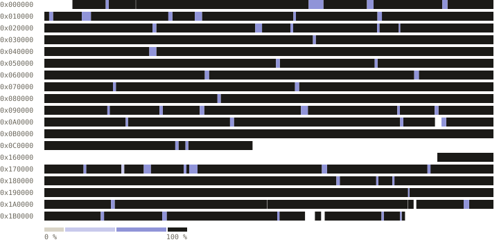

# Turok: Rage Wars decompilation

A matching decompilation of *Turok: Rage Wars* for the Nintendo 64.

> **This repository contains no game content.** You must supply a legally acquired cartridge dump. Builds are verified against its SHA256.

## Progress

<!-- progress -->
<pre><code>all      [███████████████████░]  99.97%  41,932,147 of 41,943,040 bytes, linker fill 280 bytes</code> <code>de       [████████████████████]  100.00%  8,388,669 of 8,388,608 bytes, linker fill 28 bytes</code> <code>eu       [███████████████████░]  99.93%  8,383,239 of 8,388,608 bytes, linker fill 76 bytes</code> <code>eu-x     [███████████████████░]  99.93%  8,383,183 of 8,388,608 bytes, linker fill 44 bytes</code> <code>us       [███████████████████░]  99.99%  8,388,532 of 8,388,608 bytes, linker fill 64 bytes</code> <code>us-rev1  [███████████████████░]  99.99%  8,388,524 of 8,388,608 bytes, linker fill 68 bytes</code></pre>

| de (NUS-NRWD-0, Germany). Censored German release. SHA256 `9dc401252bacb2ad7412ef003f97f28cb225d76b3cc76f430fbc27fa05067ca8` |
|---|
| <pre><code>code      [████████████████████]  100.00%  1,109,460 of 1,109,460</code> <code>data      [███████████████████░]  99.99%  254,986 of 254,998</code> <code>functions [████████████████████]  100.00%  4,249 of 4,249</code> <code>blobs     [███████████████████░]  99.99%  6,987,935 of 6,988,458</code></pre> |

| eu (NUS-NRWP-0, Europe). PAL release. SHA256 `d763cbbe485a5f9e1b7be97d5ac16735087e23d0bb62c05dc844e01b7e1156d1` |
|---|
| <pre><code>code      [████████████████████]  100.00%  1,114,888 of 1,114,888</code> <code>data      [███████████████████░]  99.99%  344,556 of 344,568</code> <code>functions [████████████████████]  100.00%  4,254 of 4,254</code> <code>blobs     [███████████████████░]  99.92%  6,903,603 of 6,908,884</code></pre> |

| eu-x (NUS-NRWX-0, Europe). PAL multi-language release. SHA256 `511f6c876586bf401faf01a270c67f26fcb7db55ed3f35759c71ab15a29de750` |
|---|
| <pre><code>code      [████████████████████]  100.00%  1,115,612 of 1,115,612</code> <code>data      [███████████████████░]  99.98%  251,820 of 251,848</code> <code>functions [████████████████████]  100.00%  4,256 of 4,256</code> <code>blobs     [███████████████████░]  99.92%  6,995,559 of 7,000,912</code></pre> |

| us (NUS-NRWE-0, North America). First NTSC release (black cartridge). SHA256 `0433043aaba2649bdd1fe717c4020550ac663c0362527aa082490f5977a3e46b` |
|---|
| <pre><code>code      [████████████████████]  100.00%  1,160,704 of 1,160,704</code> <code>data      [███████████████████░]  99.99%  208,124 of 208,136</code> <code>functions [████████████████████]  100.00%  4,325 of 4,325</code> <code>blobs     [████████████████████]  100.00%  6,999,512 of 6,999,512</code></pre> |

| us-rev1 (NUS-NRWE-1, North America). Revised NTSC release (grey cartridge). SHA256 `5dfbae59e4a3860b740ccbb28f33aad624315e30bfca6d60abd62d12a89e0089` |
|---|
| <pre><code>code      [████████████████████]  100.00%  1,132,592 of 1,132,592</code> <code>data      [███████████████████░]  99.99%  237,600 of 237,616</code> <code>functions [████████████████████]  100.00%  4,355 of 4,355</code> <code>blobs     [████████████████████]  100.00%  6,998,140 of 6,998,140</code></pre> |
<!-- /progress -->

## Development & Contributions

Contributions and corrections are welcome. Run `make check` before opening a pull request.

For detailed instructions please see [CONTRIBUTING.md](CONTRIBUTING.md).

## License

[CC0 1.0](LICENSE)

## Dependencies

<!-- dependencies -->
- [GCC 2.8.1](https://github.com/pmret/gcc-papermario)
- [abumas](https://github.com/AbuN64/mas-n64)
<!-- /dependencies -->

